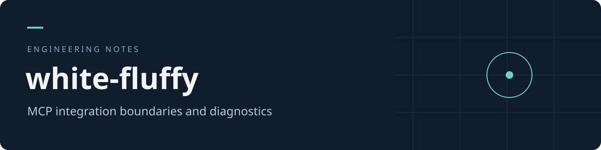

# white-fluffy

### MCP連携の境界と診断

[English](README.md) · [Português (Brasil)](README.pt-BR.md) · [日本語](README.ja.md)

ツールの機能、認証、対象アセットの権限、業務操作を分離して確認するための技術資料です。

## ドキュメント

| 資料 | 内容 |
| --- | --- |
| [アーキテクチャ](docs/architecture.ja.md) | 処理の流れと不変条件 |
| [データ契約](docs/contracts.ja.md) | 合成データによる構造例 |
| [設計判断](docs/decisions.ja.md) | 判断の理由と影響 |
| [検証方針](docs/validation.ja.md) | 確認項目と証拠の扱い |

## 公開範囲

この版は選別した技術資料です。実際の個人記録、内部の業務データ、認証情報、アカウントの画面、会話履歴、非公開バックアップのGit履歴は含みません。実装済みの範囲と設計上の提案を区別します。公開用の実行可能なアプリケーションや、本番環境での動作を保証するものではありません。
